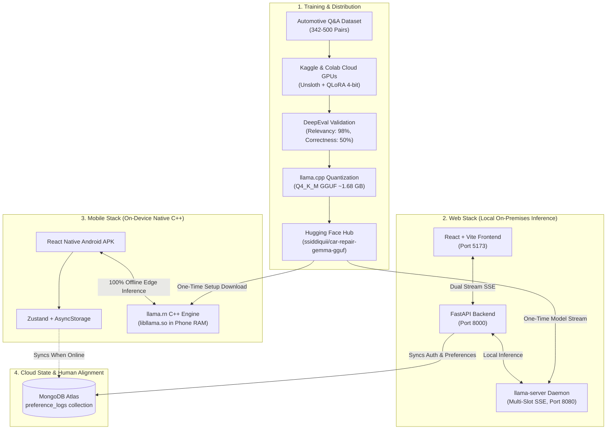

# Car Specialist AI

> **Edge-First Domain SLM & Hybrid Local Inference Architecture**  
> An automotive diagnostic AI powered by a fine-tuned **Google Gemma 2B** model. Engineered to run **100% offline on mobile hardware** via native C++ bindings (`llama.cpp` / `libllama.so`) and **locally on-premises** via an embedded web daemon—eliminating recurring cloud LLM API costs, privacy exposure, and connectivity failures.

---

## ⚡ Quick Access & Evaluation Links

- 📱 **Pre-Compiled Android APK:** [Download Standalone APK](https://expo.dev/artifacts/eas/nWLQxaqpVZAjTieNEhACBiZvBNBSwWZ_tjrMthynwG0.apk)  
  *(Ready-to-test build. Initial launch streams weights; all subsequent inference runs 100% offline in Airplane Mode).*
- 🤗 **Hugging Face Model Repository:** [ssiddiquii/car-repair-gemma-gguf](https://huggingface.co/ssiddiquii/car-repair-gemma-gguf)  
  *(Quantized GGUF Q4_K_M weights optimized for edge CPU and constrained RAM).*
- 💻 **Web Application:** `http://localhost:5173` *(Local React + Vite UI backed by FastAPI & local llama-server)*

---

## 🏎️ Engineering Overview & Problem Statement

Modern automotive troubleshooting often takes place in **zero-connectivity dead zones**—such as underground parking garages, remote highways, or rural workshops—where cloud-hosted LLMs fail completely. Furthermore, commercial LLM APIs introduce recurring token billing, unpredictable cloud latency, and telemetry privacy concerns.

**Car Specialist AI** solves this through a **Hybrid Edge-Cloud Architecture**:

| Dimension | 📱 Android Mobile Application | 💻 Web Application |
| :--- | :--- | :--- |
| **Primary Objective** | **100% Offline Edge Diagnostics** in zero-connectivity environments | **Local On-Premises Diagnostic Workspace** with full telemetry logging |
| **Runtime Engine** | Embedded native C++ `llama.cpp` via `llama.rn` (`libllama.so` in local RAM) | Local `llama-server.exe` daemon spawned by FastAPI on `localhost:8080` |
| **Network Reliance (Chat)** | **Zero internet required.** Operates in full Airplane Mode | **Zero cloud LLM API costs.** Inference is 100% local on-device |
| **Model Provisioning** | One-time Wi-Fi stream from Hugging Face (~1.68 GB) into app sandbox | Placed directly in `backend/` or loaded via local disk path |
| **Inference Throughput** | ~9–11 tokens/sec directly on mobile device CPU | High-throughput multi-threaded CPU / CUDA generation |
| **Human-in-the-Loop (RLHF)** | Local preference queue; synchronizes to MongoDB Atlas when online | Streams dual completions ($T=0.3$ vs $T=0.6$); logs preference to Atlas |

---

## 🧰 Consolidated Tech Stack

| Layer | Technologies & Frameworks |
| :--- | :--- |
| **Core ML & Fine-Tuning** | Google Gemma 2B (`gemma-4-e2b-it`), Unsloth, QLoRA (4-bit), Kaggle & Google Colab Cloud GPUs |
| **Model Evaluation** | **DeepEval** Framework, 54 Golden Domain Diagnostic Q&A pairs (Relevancy & Correctness) |
| **Edge & Local Inference** | `llama.cpp`, GGUF (Q4_K_M quantization), `llama.rn` (native C++ JNI / `libllama.so`), `llama-server` multi-slot daemon |
| **Backend & Streaming API** | FastAPI (Python 3.10+), Uvicorn, Async Server-Sent Events (SSE), HTTPX async client |
| **Frontend & Mobile** | React 18, Vite, React Native (Expo bare workflow), Zustand state management, AsyncStorage |
| **Storage & Cloud Sync** | MongoDB Atlas (`preference_logs`, `conversations`), Motor async driver, PyMongo |

---

## 📊 Fine-Tuning & Evaluation Benchmark (DeepEval)

The base model was fine-tuned on cloud GPUs (**Kaggle & Google Colab**) using **Unsloth** with **4-bit QLoRA** on a domain dataset of automotive diagnostic Q&A pairs (OBD-II codes, sensor telemetry, and fault-isolation trees). 

Pre- and post-fine-tuning checkpoints were evaluated against a golden benchmark test suite (**54 domain diagnostic Q&A pairs**) using the **DeepEval** LLM evaluation framework. **Version 7 (1 Epoch, LR=1e-5, LoRA $r=8$)** was identified as the definitive **sweet spot**—increasing automotive relevancy to **98.0%** while preserving baseline correctness and avoiding catastrophic forgetting:

```text
========================================================================
DELTA REPORT — Gemma-4 E2B-it: Baseline vs Fine-Tuned (QLoRA)
========================================================================
Metric                     Baseline   Fine-Tuned       Delta   Relative
------------------------------------------------------------------------
AnswerRelevancyMetric        0.893        0.926     + 0.033   +   3.7%
Correctness                  0.641        0.419     - 0.222   -  34.7%
------------------------------------------------------------------------
Pass Rate (≥0.7)           Baseline   Fine-Tuned       Delta
------------------------------------------------------------------------
AnswerRelevancyMetric        85.2%        98.0%     + 12.8%
Correctness                  53.7%        50.0%     -  3.7%
========================================================================
VERDICT: MARGINAL / FLAT (Optimal Sweet Spot)
========================================================================
```

### Edge Quantization Footprint

| Metric / Resource | Base Model (FP16) | Quantized Model (Q4_K_M) | Edge Optimization Impact |
| :--- | :--- | :--- | :--- |
| **Disk Footprint** | ~4.8 GB | **~1.68 GB** | **65% storage reduction** for mobile distribution |
| **RAM Utilization** | ~4.8 GB | **~1.6 GB** | **66% memory reduction** (fits in consumer device RAM) |
| **Inference Generation** | Cloud API required | **~9–11 tokens/sec** | Real-time generation directly on mobile CPU |
| **Connectivity Dependency**| Continuous Internet | **Zero (100% Offline)** | Operates in complete Airplane Mode |

---

## 🛠️ System Architecture



---

## 💻 How to Setup in Web

Follow these steps to run the complete local web stack (FastAPI backend + llama-server + Vite frontend).

### Step 1: Clone the Repository
```bash
git clone https://github.com/ssiddiquiii/car-specialist-gpt.git
cd car-specialist-gpt
```

### Step 2: Download Model Weights & Place in `backend/`
The quantized model weights are hosted on Hugging Face:
1. Download **`gemma-4-e2b-it.Q4_K_M.gguf`** (~1.68 GB) from:  
   👉 **[ssiddiquii/car-repair-gemma-gguf](https://huggingface.co/ssiddiquii/car-repair-gemma-gguf)**
2. Place the downloaded `.gguf` file directly into the **`backend/`** directory:
   ```text
   car-specialist-gpt/
   ├── backend/
   │   ├── gemma-4-e2b-it.Q4_K_M.gguf   <-- Place downloaded GGUF file here
   │   ├── llama-bin/
   │   ├── main.py
   │   ├── requirements.txt
   │   └── .env
   ├── frontend/
   └── start.bat
   ```
*(If you save the model in a custom path or under a different name, specify its location via `MODEL_PATH` in `backend/.env`).*

### Step 3: Configure Environment Variables
Copy the template and verify your configuration:
```bash
cd backend
copy .env.example .env    # On Windows
# cp .env.example .env    # On macOS/Linux
```
Inside `backend/.env`:
```env
MONGO_URI=mongodb+srv://<username>:<password>@cluster0.mongodb.net/car_specialist_gpt
DB_NAME=car_specialist_gpt
MODEL_PATH=gemma-4-e2b-it.Q4_K_M.gguf
MODEL_NAME=gemma-4-e2b-it
APP_VERSION=1.0.0
```

### Step 4: Install Dependencies & Run

#### Option A: 1-Click Runner (Windows)
Double-click [`start.bat`](start.bat) from the root directory. It will automatically:
- Activate the backend virtual environment and install dependencies.
- Spawn `llama-server.exe` on port `8080` with the GGUF model memory-mapped.
- Launch FastAPI on port `8000`.
- Start Vite dev server on port `5173` and launch your browser.

#### Option B: Manual Execution
**Terminal 1 — Backend:**
```bash
cd backend
python -m venv venv
.\venv\Scripts\activate            # Windows (macOS/Linux: source venv/bin/activate)
pip install -r requirements.txt
uvicorn main:app --reload --port 8000
```
> *On startup, FastAPI automatically detects `MODEL_PATH`, launches `llama-server.exe` on port `8080`, and prepares dual-temperature inference slots.*

**Terminal 2 — Frontend:**
```bash
cd frontend
npm install
npm run dev
```
Access the application at: **[http://localhost:5173](http://localhost:5173)**.

---

## 📱 How to Setup in Mobile (Android)

### Option 1: Install Pre-Compiled Standalone APK (Fastest Evaluation)
Evaluators can test the complete edge inference experience without installing Android Studio, NDK, or native build tools:
1. Download the **[Pre-Compiled APK](https://expo.dev/artifacts/eas/nWLQxaqpVZAjTieNEhACBiZvBNBSwWZ_tjrMthynwG0.apk)** directly onto your Android device.
2. Open and install the `.apk` package.

### Option 2: Local Native Development Build
> **⚠️ Note on Expo Go:** Standard Expo Go cannot run this application because `llama.rn` requires custom compiled native C++ shared libraries (`libllama.so`). A native build is required:

```bash
cd mobile
npm install
npx expo run:android
```

### 📶 Offline Verification Walkthrough
1. **Initial Provisioning (Online):** Open the application while connected to Wi-Fi. Authenticate and allow the app to complete its one-time streaming of model weights (~1.68 GB) into local sandboxed storage.
2. **Switch to Airplane Mode:** Turn off Wi-Fi and Cellular Data.
3. **Run Diagnostics:** Submit an automotive diagnostic query (e.g., *"Engine vibrates vigorously at 2000 RPM with P0300 code"*).
4. **Edge Generation:** The response streams in real time (~9–11 tokens/sec) generated entirely by the on-device CPU via `libllama.so` with zero network calls.
5. **Background Sync:** Select your preferred response (RLHF rating). When internet connectivity is restored later, ratings automatically sync to MongoDB Atlas.

---

## 👥 Authors & Acknowledgments

- **Lead Engineer:** Sameed Siddiqui
- **Base Model:** Google Gemma 2B (`google/gemma-4-E2B`)
- **Fine-Tuning Framework:** Unsloth, QLoRA, Kaggle & Google Colab Cloud GPUs
- **Evaluation Benchmark:** DeepEval Framework
- **Edge Runtimes:** `llama.cpp` by Georgi Gerganov & `llama.rn`

