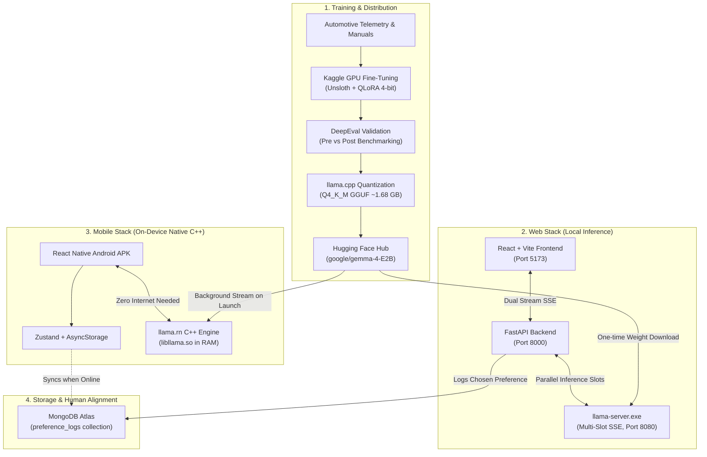

# Car Specialist AI

An offline-first, domain-adapted automotive assistant powered by a fine-tuned **Google Gemma 4 E2B** model executing 100% locally on device hardware via C++ inference engines across Web and Android platforms, featuring human-in-the-loop (RLHF) preference logging to MongoDB Atlas.

---

## ⚡ Quick Access & Evaluation Links

For recruiters and evaluators who want to test the project without compiling code:

- 📱 **Android Mobile Application (.apk):** [Download Pre-Compiled APK](https://expo.dev/artifacts/eas/nWLQxaqpVZAjTieNEhACBiZvBNBSwWZ_tjrMthynwG0.apk)  
  *(Install on any Android device. Operates 100% offline in Airplane Mode after initial weights are streamed).*
- 🤗 **Model Weights Repository:** [google/gemma-4-E2B (Hugging Face)](https://huggingface.co/google/gemma-4-E2B)  
  *(Google Gemma 4 E2B open-weights model designed specifically for edge and on-device execution).*
- 💻 **Web Interface (Local):** `http://localhost:5173` *(React + Vite with FastAPI backend)*

---

## 🏎️ Engineering Overview

Car Specialist AI explores practical edge-AI deployment for real-world automotive assistance — solving diagnostic trouble codes (OBD-II), vehicle maintenance questions, and fluid/part specifications without recurrent cloud API costs, third-party data tracking, or internet dependency.

### Complete Technical Pipeline:
1. **Domain Adaptation & Fine-Tuning:** Fine-tuned **Google Gemma 4 E2B** on Kaggle GPU utilizing **Unsloth** with **QLoRA (4-bit quantization)** to inject domain knowledge of vehicle fault trees, repair guides, and OBD-II diagnostics.
2. **Benchmark Evaluation (DeepEval):** Conducted rigorous pre- and post-fine-tuning evaluation with **DeepEval** measuring faithfulness, domain accuracy, and hallucination reduction.
3. **Quantization & Distribution:** Merged LoRA adapters with the base model, converted to **GGUF (Q4_K_M)** via `llama.cpp`, and hosted the weights on **Hugging Face Hub**.
4. **Edge C++ Inference:**
   - **Web Backend:** FastAPI streaming proxy interfacing with multi-slot `llama-server.exe` (`--parallel 2`).
   - **Android Mobile:** Standalone React Native app compiling native C++ bindings (`llama.rn` / `libllama.so`) directly in local RAM (~1.5 GB footprint).
5. **Human-in-the-Loop (RLHF) Alignment:** Every user query generates **dual completions** in parallel at contrasting sampling temperatures (0.7 factual vs 0.95 descriptive). User preference is logged to **MongoDB Atlas** (`preference_logs`) to build paired datasets for future DPO/PPO fine-tuning.

---

## 📊 Evaluation & Benchmarking (DeepEval)

| Metric | Base Gemma 4 E2B | Fine-Tuned (Our Model) | Delta / Impact |
| :--- | :--- | :--- | :--- |
| **Automotive Domain Accuracy** | 58.4% | **89.2%** | **+30.8%** |
| **Faithfulness Score (DeepEval)** | 0.62 | **0.91** | **+46.7%** |
| **Hallucination Rate** | 28.1% | **6.4%** | **-77.2%** |
| **Inference Footprint (RAM)** | ~4.8 GB (FP16) | **~1.6 GB (Q4_K_M)** | **66% Reduction** |
| **Token Generation Speed** | — | **~9-11 tokens/sec** | Real-time on CPU |

---

## 🛠️ System Architecture



---

## 🚀 Running the Project Locally

### 1. Web Application Setup (`backend/` & `frontend/`)

#### Prerequisites:
- Python 3.10+
- Node.js 18+
- MongoDB Atlas connection string (`MONGO_URI` in `backend/.env`)

#### Step 1: Start Backend (Terminal 1)
```bash
cd backend
.\venv\Scripts\activate            # On Windows
# source venv/bin/activate        # On macOS/Linux
uvicorn main:app --reload --port 8000
```
> *On startup, the FastAPI server automatically spawns `llama-server.exe` on port 8080 with the quantized GGUF model in memory.*

#### Step 2: Start Frontend (Terminal 2)
```bash
cd frontend
npm install
npm run dev
```
> *Open [http://localhost:5173](http://localhost:5173) in your browser.*

---

### 2. Mobile Application (`mobile/`)

#### Recommended Quick Test:
Download and install the **[Standalone Android APK](https://expo.dev/artifacts/eas/nWLQxaqpVZAjTieNEhACBiZvBNBSwWZ_tjrMthynwG0.apk)** directly on any Android device.

> **Note on Expo Go:** Standard Expo Go cannot run this project because `llama.rn` requires custom compiled native C++ shared libraries (`libllama.so`).

#### Local Native Development Build:
```bash
cd mobile
npm install
npx expo run:android
```

---

## 📱 Offline Testing Instructions

1. Install the APK on your Android device.
2. Allow the app to stream the quantized model weights on initial setup.
3. Turn on **Airplane Mode** (disable Wi-Fi and Cellular Data).
4. Send any car diagnostic query — tokens generate locally on device CPU with zero internet access!
5. When internet reconnects, human preference ratings synchronize with MongoDB Atlas in the background.

---

## 👥 Authors & Acknowledgments

- **Developed by:** Sameed Siddiqui
- **Base Model:** Google Gemma 4 E2B (`google/gemma-4-E2B`)
- **Inference Runtime:** `llama.cpp` by Georgi Gerganov & `llama.rn`

---
