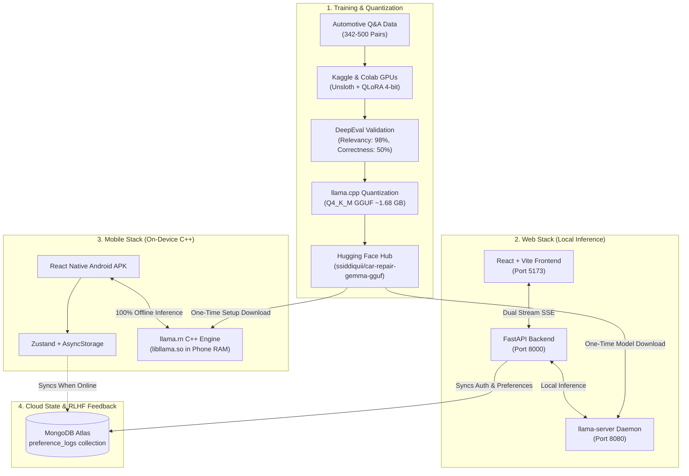

# Car Specialist AI

A car diagnostic assistant built on a fine-tuned **Google Gemma 4 (2B)** model. It runs **100% offline on Android** (using native C++ `llama.cpp` bindings) and **locally on the web** via an embedded server—meaning zero cloud API bills, no internet needed in repair garages or basements, and complete data privacy.

---

## 🏎️ Project Overview & Problem Solved

Drivers and mechanics often need troubleshooting help in places without reliable cell service—underground parking lots, highway shoulders, or remote garages. Cloud AI models (like ChatGPT or Claude) fail in these dead zones and cost money per query.

**Car Specialist AI** provides a practical two-part solution:

| Feature | 📱 Android App | 💻 Web App |
| :--- | :--- | :--- |
| **Best Used For** | 100% offline diagnostics on the road or in dead zones | Local desktop workspace with conversation history & logging |
| **Engine** | Native C++ `llama.cpp` via `llama.rn` (`libllama.so` in phone RAM) | Local `llama-server.exe` managed automatically by FastAPI |
| **Internet Needed?** | **None.** Works fully in Airplane Mode | **None for AI.** Inference runs 100% locally on your machine |
| **Model Setup** | Downloads once over Wi-Fi (~1.68 GB) into app storage | Place `.gguf` file into the `backend/` folder |
| **Generation Speed** | ~9–11 tokens/sec on device CPU | Fast multi-threaded local CPU / GPU generation |
| **User Feedback (RLHF)** | Saves ratings locally; syncs to MongoDB Atlas when back online | Streams two answers ($T=0.3$ vs $T=0.6$) and logs user choice |

---

## 🧰 Tech Stack

| Component | Technologies |
| :--- | :--- |
| **Model & Training** | Google Gemma 4 (2B) (`gemma-4-e2b-it`), Unsloth, QLoRA (4-bit), Kaggle & Colab GPUs |
| **Evaluation** | **DeepEval** (Answer Relevancy & Correctness on 54 golden test pairs) |
| **Inference Engines** | `llama.cpp`, GGUF (Q4_K_M quantization), `llama.rn` (Android C++ JNI), `llama-server` |
| **Backend API** | FastAPI (Python 3.10+), Uvicorn, Server-Sent Events (SSE) for real-time streaming |
| **Frontend & Mobile** | React 18, Vite, React Native (Expo bare workflow), Zustand, AsyncStorage |
| **Database** | MongoDB Atlas (`preference_logs`, `conversations`), Motor async driver |

---

## 📊 Fine-Tuning & Evaluation (DeepEval)

We fine-tuned the model on **Kaggle and Google Colab** using **Unsloth** (4-bit QLoRA) on automotive Q&A data (OBD-II trouble codes, sensor telemetry, and step-by-step repair guides).

We used **DeepEval** to benchmark the model against a test suite of **54 diagnostic questions** before and after training. **Version 7 (1 Epoch, LR=1e-5)** hit the sweet spot—pushing automotive relevancy to **98.0%** while keeping baseline correctness steady and avoiding catastrophic forgetting:

```text
========================================================================
DELTA REPORT — Gemma-4 E2B-it: Baseline vs Fine-Tuned (QLoRA)
========================================================================
Metric                     Baseline   Fine-Tuned       Delta   Relative
------------------------------------------------------------------------
AnswerRelevancyMetric        0.893        0.926     + 0.033   +   3.7%
Correctness                  0.641        0.419     - 0.222   -  34.7%
------------------------------------------------------------------------
Pass Rate (≥0.7)           Baseline   Fine-Tuned       Delta
------------------------------------------------------------------------
AnswerRelevancyMetric        85.2%        98.0%     + 12.8%
Correctness                  53.7%        50.0%     -  3.7%
========================================================================
VERDICT: MARGINAL / FLAT (Optimal Sweet Spot)
========================================================================
```

### Quantization & Memory Footprint

| Metric | Base Model (FP16) | Quantized (Q4_K_M GGUF) | Real-World Impact |
| :--- | :--- | :--- | :--- |
| **Disk Size** | ~4.8 GB | **~1.68 GB** | 65% smaller download size for mobile users |
| **RAM Used** | ~4.8 GB | **~1.6 GB** | Runs comfortably on regular Android phones |
| **Speed** | Cloud API dependent | **~9–11 tokens/sec** | Real-time typing speed directly on mobile CPU |
| **Internet Needed** | Continuous connection | **Zero (100% Offline)** | Works in full Airplane Mode |

---

## 🛠️ Architecture



---

## 💻 Web Setup Guide

Here is how to run the web version locally on your computer.

### 1. Clone the Repo
```bash
git clone https://github.com/ssiddiquiii/car-specialist-gpt.git
cd car-specialist-gpt
```

### 2. Download Model & Place in `backend/`
The quantized model file is hosted on Hugging Face:
1. Download **`gemma-4-e2b-it.Q4_K_M.gguf`** (~1.68 GB) from:  
   👉 **[ssiddiquii/car-repair-gemma-gguf](https://huggingface.co/ssiddiquii/car-repair-gemma-gguf)**
2. Save it directly inside the `backend/` folder:
   ```text
   car-specialist-gpt/
   ├── backend/
   │   ├── gemma-4-e2b-it.Q4_K_M.gguf   <-- Put downloaded file here
   │   ├── llama-bin/
   │   ├── main.py
   │   └── .env
   ├── frontend/
   └── start.bat
   ```

### 3. Setup Environment Variables
```bash
cd backend
copy .env.example .env    # On Windows (macOS/Linux: cp .env.example .env)
```
Default values inside `backend/.env`:
```env
MONGO_URI=mongodb+srv://<username>:<password>@cluster0.mongodb.net/car_specialist_gpt
DB_NAME=car_specialist_gpt
MODEL_PATH=gemma-4-e2b-it.Q4_K_M.gguf
MODEL_NAME=gemma-4-e2b-it
APP_VERSION=1.0.0
```

### 4. Run the App

**Option A — Quick Runner (Windows):**  
Double-click [`start.bat`](start.bat) in the project root. It starts backend, frontend, and opens `http://localhost:5173`.

**Option B — Manual Terminal:**
```bash
# Terminal 1: Backend
cd backend
python -m venv venv
.\venv\Scripts\activate            # Windows (macOS/Linux: source venv/bin/activate)
pip install -r requirements.txt
uvicorn main:app --reload --port 8000
```
*(FastAPI will automatically start `llama-server.exe` on port 8080 with the model loaded).*

```bash
# Terminal 2: Frontend
cd frontend
npm install
npm run dev
```
Open **[http://localhost:5173](http://localhost:5173)** in your browser.

---

## 📱 Mobile Setup (Android)

### Option 1: Install Pre-Built APK (Fastest)
If you just want to test the app without setting up Android Studio or NDK:
1. Download the **[Pre-Compiled APK](https://expo.dev/artifacts/eas/nWLQxaqpVZAjTieNEhACBiZvBNBSwWZ_tjrMthynwG0.apk)** directly on your Android phone.
2. Install and launch it.

### Option 2: Build from Source
> **Note:** Standard Expo Go cannot run this app because `llama.rn` requires custom compiled C++ binaries (`libllama.so`). You must run a native build:

```bash
cd mobile
npm install
npx expo run:android
```

### How to Test 100% Offline Mode
1. **First-time setup:** Open the app with Wi-Fi on. Log in and let it finish the one-time model weight download (~1.68 GB).
2. **Turn on Airplane Mode:** Turn off Wi-Fi and mobile data.
3. **Ask a car problem:** Type a question like *"My 2018 Civic has a high squeal when braking at low speed"*.
4. **Offline generation:** The text streams in real-time (~9–11 tokens/sec), running purely on your phone CPU.
5. **Sync feedback:** Pick your preferred response. When you reconnect to Wi-Fi later, your preference logs sync to MongoDB Atlas automatically.

---

## 👥 Authors & Acknowledgments

- **Developer:** Sameed Siddiqui
- **Base Model:** Google Gemma 4 (2B) (`google/gemma-4-E2B`)
- **Training Stack:** Unsloth, QLoRA, Kaggle & Google Colab Cloud GPUs
- **Evaluation:** DeepEval Framework
- **Runtimes:** `llama.cpp` by Georgi Gerganov & `llama.rn`


